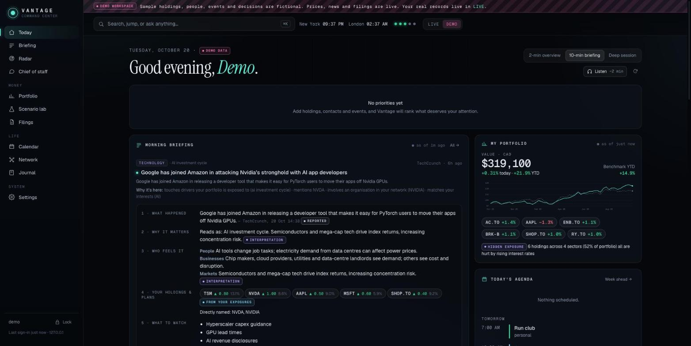
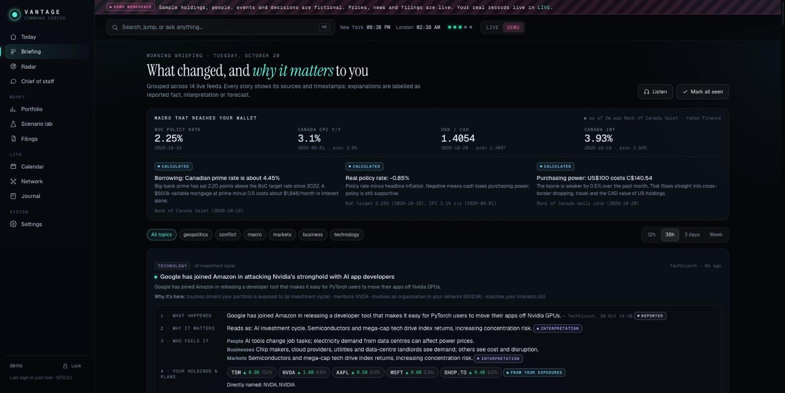
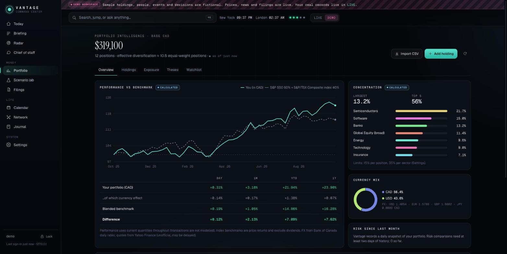
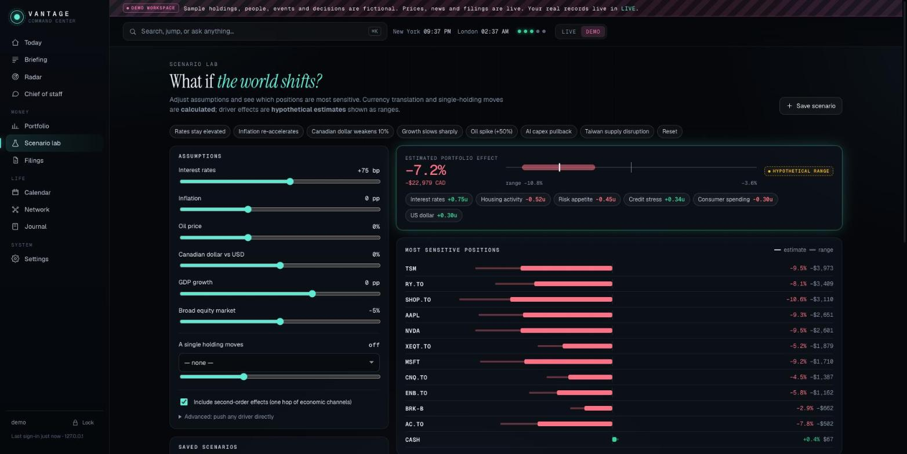
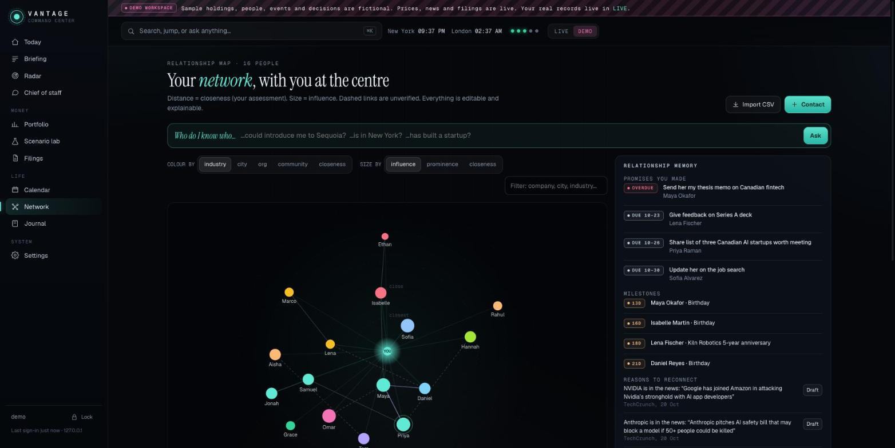

# Vantage — personal command center

A private, single-user website that answers, every time you sign in:
**what changed in the world, how it affects your money and plans, what deserves attention today, who to connect with, and what you're overlooking.**

Runs entirely on your Mac. Python 3 standard library + SQLite. No build step, no dependencies, no cloud account.

<p align="center">
  
</p>
<p align="center">
  
  
</p>
<p align="center">
  
  
</p>

The screens above are the DEMO workspace: fictional holdings, people and events; the prices, news and filings in them are live.

## Start it

Double-click **`Start Vantage.command`** (or run `python3 vantage.py`) and open <http://localhost:8790>.

First run: the page asks for a **one-time setup code**. It's printed in the terminal window and saved in `data/setup-code.txt` (deleted once your account exists). Choose a username and a strong password. That's the only way in; the code can't be reused.

Then turn on two-factor in **Settings → Security**, and follow the setup checklist on the Today page.
Want to look around first? Flip the **LIVE / DEMO** switch: the demo workspace is fully populated with clearly labelled fictional holdings, people and events (prices, news and filings in it are real).

Forgot your password: `python3 vantage.py --reset-password` (also disables 2FA and signs out every session).

## What's inside

| Area | What it does |
|---|---|
| **Today** | 2-min / 10-min / deep modes · "since your last visit" · three ranked priorities with reasons · briefing, portfolio, agenda, people, radar · audio briefing (on-device speech) |
| **Briefing** | 15 live feeds, de-duplicated into developments; each explained in five labelled parts (what happened · why it matters · who feels it · your holdings & plans · what to watch); macro translated into prime rate, real rate, purchasing power |
| **How does this affect me?** | Interactive consequence map: event → economic drivers → second-order effects → industries → your holdings and plans. Every link shows logic, evidence, uncertainty, horizon, offsets and "what would have to happen for this to matter" |
| **Portfolio** | Holdings (manual or CSV), live quotes, base-currency performance vs blended benchmark with the currency effect split out, concentration, sector/geography/currency/account mix, driver sensitivities, **hidden exposure detection**, living thesis per holding with revision history, **thesis monitor**, SEC filings, catalysts |
| **Scenario lab** | Rates, inflation, oil, CAD, growth, market, single-holding shocks + any driver; calculated vs estimated effects, ranges, second-order channels, historical comparisons, limitations; save scenarios |
| **Filings** | Follow 13F filers (15 presets or any CIK): new / increased / reduced / exited, report period vs filing date, overlap with your holdings & watchlist, patterns across investors, recent 8-K/10-Q/10-K from companies you hold |
| **Calendar** | Your events (recurring, time zones), ICS subscriptions (Google/iCloud/Outlook), birthdays & milestones from contacts, promises, central-bank decisions, 13F deadlines, options expiries, estimated earnings dates, decision reviews · **week ahead** (load, conflicts, prep) · **preparation mode** |
| **Network** | Force-directed map with you at the centre; closeness, influence and prominence kept separate and editable; colour/size/filter · **"Who do I know who…?"** with verified/unverified connection paths · relationship memory (lost touch, promises, milestones, reasons to reconnect) · message drafts (never sent) |
| **Chief of staff** | Ask across everything; answers split into what the records show / interpretation / missing, with links back; one-click save as note, reminder, watchlist item or draft |
| **Journal** | Decisions with assumptions + confidence; reasoning locks after 24 h; **replay** puts what you knew beside what happened; assumption verdicts build calibration |
| **Radar** | Alerts ranked by relevance × impact × urgency × confidence, each explaining why it appeared; grouping; 👍/👎/mute tuning; "what deserves a second look" |

## Trust rules the code enforces

- Every figure is labelled **reported · calculated · estimate · interpretation · forecast · Claude · demo**.
- Nothing is invented: failed fetches show the last good value with its age, or nothing. Freshness LEDs sit in the top bar; details in **Settings → Integrations**.
- Demo data lives only in the DEMO workspace, watermarked on every page.
- Every record change is appended to a revision log. Nothing is sent, posted or traded on your behalf.

## Data sources

| Source | Needs | Notes |
|---|---|---|
| News (BBC, Guardian, Al Jazeera, NYT, CNBC, MarketWatch, CBC, Fed, Bank of Canada, Ars, TechCrunch, HN) | nothing | public RSS, every 15 min |
| Quotes & index history | nothing | Yahoo Finance public chart endpoint: **unofficial, may be delayed**. Swap for a paid API for production-grade data |
| FX, policy rate, yields, CPI | nothing | Bank of Canada Valet API (official) |
| 13F, 8-K, 10-Q/K | your email in Settings (SEC policy) | SEC EDGAR, politely rate-limited with back-off |
| Calendars | a secret ICS link | read-only; two-way Google/Microsoft sync would need OAuth app registration |
| Contacts | LinkedIn/Google CSV export | no LinkedIn API access exists for personal use |
| Claude (optional) | Anthropic API key + `python3 -m pip install --target vendor anthropic` | powers story analysis, deeper consequence maps, thesis assessment, meeting briefs, drafts and chief-of-staff synthesis. Defaults to `claude-opus-5` with server-side refusal fallback |

Not integrated (by design or pending credentials): brokerage account sync (use CSV), email, Canadian SEDAR+ filings (no free API), real-time market data.

## Using it on your phone

It listens on this Mac only. For phone access, put it behind HTTPS, e.g. **Tailscale** (`tailscale serve 8790`) or a Cloudflare Tunnel, and start with `python3 vantage.py --host 0.0.0.0`. Cookies get the `Secure` flag automatically behind an HTTPS proxy that sets `X-Forwarded-Proto`.

## Security

PBKDF2-SHA256 (600k) passwords · 256-bit session tokens stored only as hashes · HttpOnly + SameSite=Strict cookies · CSRF header + origin checks · strict CSP (no inline scripts) · exponential login back-off · TOTP 2FA (each code accepted once) with recovery codes · session list + revoke · security audit log · DB and backups `chmod 600` in a `700` folder · daily automatic backups (20 kept). For encryption at rest keep FileVault on.

## Layout

```
vantage.py            entry point (--host, --port, --data, --reset-password)
core/server.py        HTTP server, routes, background refresher
core/auth.py          passwords, sessions, TOTP, lockouts
core/db.py            SQLite, records + append-only revisions, cache, backups
core/feeds.py         RSS, quotes, Bank of Canada, SEC EDGAR, ICS
core/kb.py            economic drivers, sector sensitivities, transmission channels, event patterns
core/engine.py        portfolio analytics, hidden exposure, consequence map, scenario lab
core/intel.py         briefing, calendar, week ahead, prep, network, radar, priorities
core/cos.py           chief-of-staff retrieval
core/ai.py            optional Claude layer
static/               single-page app (vanilla JS, hand-built SVG/canvas charts)
tests/                backend tests (standard library only)
cloud/tests/          Cloudflare Worker tests (Node 22+, in-memory SQLite stand-in for D1)
data/                 your database, backups (git-ignored)
```

## Tests

```
python3 -m unittest discover -s tests          # local server: auth, records, calendar parsing, HTTP API
node --test cloud/tests/worker.test.mjs        # Cloudflare Worker: auth, records, decision lock, MFA
```

Both run offline against throwaway databases, and run on every push via GitHub Actions.
